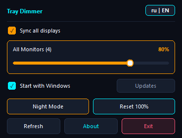
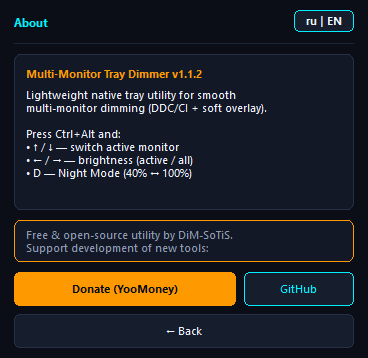
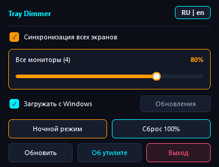

# Multi-Monitor Tray Dimmer

> **Language:** [English](#english) · [Русский](#русский)

---

## English

> Lightweight native Windows system-tray utility (Rust, ~635 KB with embedded icon, no console window, zero runtime dependencies) to smoothly dim and control brightness **per monitor or across all displays in sync** via a Cosmic Glass HUD tray flyout, hardware DDC/CI, and global hotkeys.

### Screenshots (v1.1.2 — EN)

| Control Panel (Cosmic Glass HUD) | About & Donate |
| :---: | :---: |
|  |  |

### Download

- **[Download latest release (.exe) — GitHub Releases](https://github.com/DiM-SoTiS/multi-monitor-tray-dimmer/releases/latest)**
- **More utilities & apps:** [DiM-SoTiS / Apps Catalog](https://github.com/DiM-SoTiS/apps-catalog)

Just download `multi-monitor-tray-dimmer.exe` and run it — no installation required (portable).

### Features (v1.1.2)
- **Cosmic Glass HUD tray flyout:** smooth brightness sliders (`20%–100%`) for each display using Windows system numbering (`Monitor 1 (Primary)`, `Monitor 2`, …) with an active-monitor border highlight.
- **Sync all displays:** toggle *"Sync all displays"* to collapse all sliders into a single master slider, or disable it to adjust each monitor independently.
- **Hybrid dimming:** hardware **DDC/CI** (where supported) combined with a smooth click-through overlay (works on any monitor, even below hardware minimum brightness).
- **Global hotkeys:**
  - `Ctrl + Alt + ↑ / ↓` — switch the active monitor (automatically turns off sync mode, highlights the active card, and shows a toast notification).
  - `Ctrl + Alt + ← / →` — decrease / increase brightness of the active monitor (or all monitors when sync is enabled) by `±10%`.
  - `Ctrl + Alt + D` — quick Night Mode toggle (`40%` ↔ `100%`).
- **Single-instance guard & tray recovery:** only one instance runs at a time, and the tray icon automatically recovers if `explorer.exe` restarts.
- **`RU | EN` language switcher** with automatic Windows locale detection.
- **Launch with Windows:** built-in autostart checkbox right in the flyout.
- **One-click GitHub Releases updater** built into the panel.
- **About & Donate view** with quick links to GitHub and author support.
- **Persistent settings** (per-monitor brightness, language, sync mode) saved in `%APPDATA%\multi-monitor-tray-dimmer\config.ini`.

### Build from source

```powershell
cargo test
cargo build --release
```

Output binary: `target\release\multi-monitor-tray-dimmer.exe`.

### Support & Feedback
- Give this repository a **★ Star** to help others discover the utility.
- **Support development (YooMoney):** [Donate](https://yoomoney.ru/fundraise/1LP6PQKIMJN.261125)
- Found a bug or have a feature idea? Open an [Issue](https://github.com/DiM-SoTiS/multi-monitor-tray-dimmer/issues).

---

## Русский

> Нативная Windows-утилита в системном трее (Rust, ~635 КБ со встроенной иконкой, без консольного окна и сторонних зависимостей) для плавной регулировки яркости и затемнения **каждого монитора по отдельности или всех сразу** из панели Cosmic Glass HUD в трее и по глобальным хоткеям.

### Скриншоты (v1.1.2 — RU)

| Панель управления (Cosmic Glass HUD) | Об утилите / About & Donate |
| :---: | :---: |
|  |  |

### Скачать

- **[Скачать последнюю версию (.exe) — GitHub Releases](https://github.com/DiM-SoTiS/multi-monitor-tray-dimmer/releases/latest)**
- **Все наши утилиты и приложения:** [DiM-SoTiS / Apps Catalog](https://github.com/DiM-SoTiS/apps-catalog)

Просто скачайте `multi-monitor-tray-dimmer.exe` и запустите — установка не требуется (portable).

### Возможности (v1.1.2)
- **Панель Cosmic Glass HUD в трее:** плавные ползунки яркости (`20%–100%`) для каждого монитора с системной нумерацией Windows (`Монитор 1 (Основной)`, `Монитор 2`, …) и подсветкой активного экрана.
- **Синхронизация экранов:** галочка «Синхронизация всех экранов» объединяет ползунки в один общий регулятор; при выключении каждый монитор настраивается независимо.
- **Гибридное затемнение:** аппаратный **DDC/CI** (где поддерживается) + плавный некликабельный оверлей затемнения (работает на любом мониторе, даже ниже аппаратного минимума).
- **Глобальные хоткеи:**
  - `Ctrl + Alt + ↑ / ↓` — переключить активный монитор (автоматически снимает синхронизацию, подсвечивает активную карточку и показывает toast-подсказку).
  - `Ctrl + Alt + ← / →` — уменьшить / увеличить яркость активного монитора (или всех мониторов при включённой синхронизации) на `±10%`.
  - `Ctrl + Alt + D` — быстрый «Ночной режим» (`40%` ↔ `100%`).
- **Защита от дублей и восстановление в трее:** одновременно работает только один экземпляр утилиты, а иконка автоматически возвращается в трей после перезапуска `explorer.exe`.
- **Переключение языка `RU | EN`** с автоопределением языка Windows.
- **Автозапуск с Windows:** галочка «Загружать с Windows» в панели управления.
- **Встроенная проверка и обновление с GitHub Releases** одной кнопкой.
- **Раздел «Об утилите / About»** с описанием возможностей и ссылками на GitHub и поддержку автора.
- **Сохранение настроек** (уровни яркости, язык, режим синхронизации) в `%APPDATA%\multi-monitor-tray-dimmer\config.ini`.

### Сборка из исходников

```powershell
cargo test
cargo build --release
```

Готовый исполняемый файл: `target\release\multi-monitor-tray-dimmer.exe`.

### Поддержать разработку и обратная связь

Утилита бесплатна и с открытым исходным кодом. Если она оказалась полезной и экономит вам время, вы можете поддержать выход новых бесплатных утилит для Windows и Android:

- Поставьте звезду (**★ Star**) этому репозиторию — это сильно помогает другим пользователям найти утилиту.
- **Донат / Поддержка автора (ЮMoney):** [Поддержать разработку](https://yoomoney.ru/fundraise/1LP6PQKIMJN.261125)
- Загляните в наш общий каталог релизов: **[DiM-SoTiS/apps-catalog](https://github.com/DiM-SoTiS/apps-catalog)**
- Нашли баг или есть идея для новой функции? Создайте [Issue](https://github.com/DiM-SoTiS/multi-monitor-tray-dimmer/issues).
