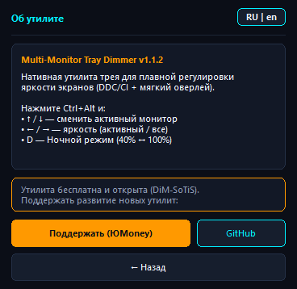

# Multi-Monitor Tray Dimmer

> Нативная Windows-утилита в системном трее (Rust, ~620 КБ со встроенной иконкой, без консольного окна и сторонних зависимостей) для плавной регулировки яркости и затемнения **каждого монитора по отдельности или всех сразу** из панели Cosmic Glass HUD в трее и по глобальным хоткеям.
>
> *Lightweight native Windows system-tray utility (Rust, zero runtime dependencies) to adjust brightness & dimming per monitor or in sync via DDC/CI + smooth overlay, Cosmic Glass HUD flyout, and global hotkeys.*

## Скриншоты / Screenshots (v1.1.2)

| Панель управления (Cosmic Glass HUD) | Об утилите / About & Donate |
| :---: | :---: |
|  |  |

## Скачать / Download

- **[Скачать последнюю версию (.exe) — GitHub Releases](https://github.com/DiM-SoTiS/multi-monitor-tray-dimmer/releases/latest)**
- **Все наши утилиты и приложения:** [DiM-SoTiS / Apps Catalog](https://github.com/DiM-SoTiS/apps-catalog)

Просто скачайте `multi-monitor-tray-dimmer.exe` и запустите — установка не требуется (portable).

## Возможности / Features (v1.1.2)
- **Панель Cosmic Glass HUD в трее:** плавные ползунки яркости (`20%–100%`) для каждого монитора с системной нумерацией Windows (`Монитор 1 (Основной)`, `Монитор 2`, …) и подсветкой активного экрана.
- **Синхронизация экранов:** галочка «Синхронизация всех экранов» объединяет ползунки в один общий регулятор; при выключении каждый монитор настраивается независимо.
- **Гибридное затемнение:** аппаратный **DDC/CI** (где поддерживается) + плавный некликабельный оверлей затемнения (работает на любом мониторе, даже ниже аппаратного минимума).
- **Глобальные хоткеи:**
  - `Ctrl + Alt + ↑ / ↓` — переключить активный монитор (автоматически снимает синхронизацию и показывает toast-подсказку).
  - `Ctrl + Alt + ← / →` — уменьшить / увеличить яркость активного монитора (или всех мониторов при включённой синхронизации) на `±10%`.
  - `Ctrl + Alt + D` — быстрый «Ночной режим» (`40%` ↔ `100%`).
- **Защита от дублей и восстановление в трее:** одновременно работает только один экземпляр утилиты, а иконка автоматически возвращается в трей после перезапуска `explorer.exe`.
- **Переключение языка `RU | EN`** с автоопределением языка Windows.
- **Автозапуск с Windows:** галочка «Загружать с Windows» в панели управления.
- **Встроенная проверка и обновление с GitHub Releases** одной кнопкой.
- **Раздел «Об утилите / About»** с описанием возможностей и ссылками на GitHub и поддержку автора.
- **Сохранение настроек** (уровни яркости, язык, режим синхронизации) в `%APPDATA%\multi-monitor-tray-dimmer\config.ini`.

## Сборка из исходников / Build from source

```powershell
cargo test
cargo build --release
```

Готовый исполняемый файл: `target\release\multi-monitor-tray-dimmer.exe`.

## Поддержать разработку / Support & Donate

Утилита бесплатна и с открытым исходным кодом. Если она оказалась полезной и экономит вам время, вы можете поддержать выход новых бесплатных утилит для Windows и Android:

- Поставьте звезду (**★ Star**) этому репозиторию — это сильно помогает другим пользователям найти утилиту.
- **Донат / Поддержка автора (ЮMoney):** [Поддержать разработку](https://yoomoney.ru/fundraise/1LP6PQKIMJN.261125)
- Загляните в наш общий каталог релизов: **[DiM-SoTiS/apps-catalog](https://github.com/DiM-SoTiS/apps-catalog)**

## Обратная связь / Feedback
Нашли баг или есть идея для новой функции? Создайте [Issue](https://github.com/DiM-SoTiS/multi-monitor-tray-dimmer/issues).
